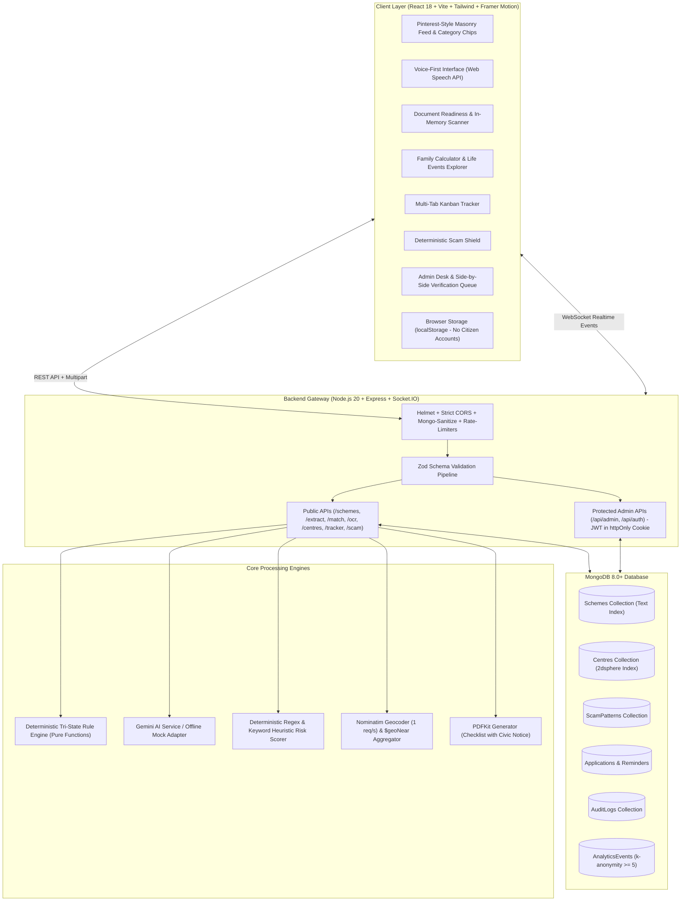

# Scheme-Saathi: Technical Architecture & System Design

**Scheme-Saathi** (ಸ್ಕೀಮ್ ಸಾಥಿ / स्कीम साथी) is an open-source, privacy-preserving, real-time civic-technology platform designed to help Indian citizens discover, understand, and apply for verified government welfare entitlements they qualify for.

---

## 1. System Architecture Diagram

---

## 2. Non-Negotiable Rules & Compliance Matrix

| Rule | Implementation Mechanism | Verification Point |
|---|---|---|
| **1. Never Invent Facts** | Every seeded and ingested scheme stores `sourceUrl` and `lastVerified`. | Schema validator (`npm run validate`) fails if `sourceUrl` is missing or invalid. |
| **2. Verification Gate** | All new ingestions default to `verificationStatus: 'needs_review'`. Only `verified` records appear publicly unless `SHOW_UNVERIFIED=true`. | Enforced in `Scheme` Mongoose model default and query filters. |
| **3. Polite Web Crawling** | Robots.txt checked with `robots-parser`; rate-limited to 1 request per 2000ms with respectful `User-Agent`. | Fallback to admin "paste text" flow when fetching is blocked. |
| **4. Deterministic Decisions** | Eligibility qualification is calculated exclusively by the pure-function Rule Engine. Zero LLM hallucinations. | Rule engine unit tests (22/22 passed). LLM is used strictly for speech parsing, OCR, and drafting. |
| **5. Secret Management** | Environment secrets live in `.env`. No credentials or keys bundled to client. | Protected via Vite `VITE_` prefix isolation. |
| **6. Privacy & Zero Accounts** | No citizen passwords or accounts. Profiles persist only in the user's browser `localStorage`. Uploaded documents processed in memory (RAM) and never stored on disk. | Multer memoryStorage; Aadhaar numbers masked (`XXXX-XXXX-1234`). |
| **7. Distinct Editorial Brand** | Warm editorial aesthetic (`#FBF8F3`, `#1C1B19`, `#1F6F5B`, `#E8590C`), Fraunces display typography, organic procedural SVGs. | Custom `tokens.css` with zero template or generic purple gradients. |
| **8. Mandatory Civic Disclaimer** | "Guidance only. Final eligibility is decided by the issuing department." | Rendered across all scheme views, modal footer, and exported PDF headers. |
| **9. Offline-Safe Demo Mode** | `USE_MOCK_AI=true` provides instantaneous deterministic fixtures for all features. | 100% demoable offline without API keys. |

---

## 3. Deterministic Tri-State Rule Engine

### Tri-State Truth Table
The rule engine evaluates leaves to `true` (satisfied), `false` (violated), or `null` (unknown profile field).

- **Combinator `all`**:
  - `false` if any child is `false`.
  - `null` if no child is `false`, but one or more are `null`.
  - `true` only if all children are `true`.
- **Combinator `any`**:
  - `true` if any child is `true`.
  - `false` only if all children are `false`.
  - `null` if none are `true`, and one or more are `null`.
- **Combinator `not`**:
  - Inverts `true` to `false` and `false` to `true`. Returns `null` if child is `null`.

### Status Resolution:
- **`eligible`**: The scheme condition tree evaluates completely to `true`.
- **`maybe`**: No hard disqualification (`false`), but missing unknown profile fields require follow-up.
- **`not_eligible`**: One or more non-fixable rules evaluated to `false`. Fixable rules (e.g. renewal of income certificate, age threshold within months) generate **Near-Miss** opportunity hints.
